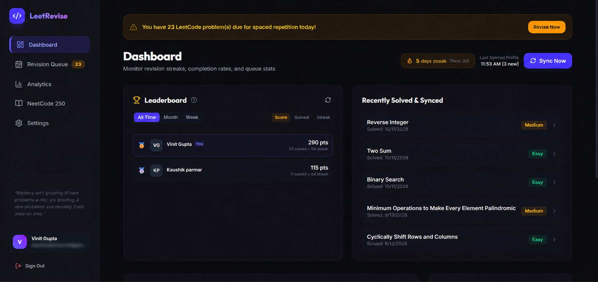

<div align="center">

# ⚡ LeetRevise

**Master algorithmic patterns through intelligent, adaptive spaced repetition.**

[](https://www.typescriptlang.org/)
[](https://react.dev/)
[](https://nodejs.org/)
[](https://expressjs.com/)
[](https://www.postgresql.org/)
[](https://www.prisma.io/)
[](https://tailwindcss.com/)
[](LICENSE)

<br />

<p align="center">
  <a href="#about-the-project">About</a> •
  <a href="#key-features">Key Features</a> •
  <a href="#tech-stack">Tech Stack</a> •
  <a href="#getting-started">Getting Started</a> •
  <a href="#usage">Usage</a> •
  <a href="#roadmap">Roadmap</a> •
  <a href="#contributing">Contributing</a>
</p>

</div>

---

## About the Project

Software engineers often solve hundreds of LeetCode problems only to forget foundational patterns—such as dynamic programming state transitions, graph traversals, and two-pointer templates—weeks later.

**LeetRevise** solves this retention dilemma by replacing passive re-solving with an **adaptive, 6-stage spaced repetition schedule**. The platform automatically imports your accepted submissions from LeetCode, calculates optimal milestone review intervals, prioritizes high-impact scheduled revisions, and delivers targeted daily problems to your inbox for revision so you never lose problem intuition.

<div align="center">
  
</div>

---

## Key Features

- **Automated LeetCode Synchronization:** Connect your public LeetCode profile to fetch accepted submissions via GraphQL, with manual slug/URL import fallbacks.
- **Priority-First Revision Queue:** Intelligent multi-tier sorting ensures scheduled stage transitions due today appear at the top, preventing older backlog imports from overshadowing active revision cycles.
- **Adaptive 6-Stage Repetition Engine:** Dynamic interval scaling ($1\text{d} \to 3\text{d} \to 7\text{d} \to 14\text{d} \to 30\text{d} \to 90\text{d}$) that adjusts intervals when solutions are solved easily, maintained upon effort, or reset when forgotten.
- **Automated Daily Email Reminders:** Scheduled web-cron triggers personalized daily digest emails via Brevo, featuring one-tap access to markdown solution notes, difficulty badges, and direct LeetCode links.
- **Rich Analytics & Community Leaderboard:** Interactive dashboards tracking consistency streaks, stage progression distribution, difficulty breakdowns, and weekly recall metrics.

---

## Tech Stack

| Category           | Technologies                                                                           |
| :----------------- | :------------------------------------------------------------------------------------- |
| **Frontend**       | React 19, TypeScript, Vite, Tailwind CSS, TanStack React Query, Recharts, Lucide Icons |
| **Backend**        | Node.js, Express.js, TypeScript, Zod, Cookie-Parser, CORS                              |
| **Database & ORM** | PostgreSQL (Neon Serverless Postgres), Prisma ORM                                      |
| **Email & Jobs**   | Brevo (Sendinblue) Transactional API, cron-job.org HTTP Trigger                        |
| **Authentication** | JWT (JSON Web Tokens), HTTP-Only Cookies, Bcrypt.js                                    |
| **Deployment**     | Vercel (Client SPA), Render (API Web Service)                                          |

---

## Getting Started

Follow these instructions to configure and run a local development instance of LeetRevise.

### Prerequisites

Ensure you have the following installed on your machine:

- **Node.js:** `v18.0.0` or higher ([Download Node.js](https://nodejs.org/))
- **npm:** `v9.0.0` or higher (Bundled with Node.js)
- **Git:** ([Download Git](https://git-scm.com/))

### Installation

1. **Clone the repository:**

    ```bash
    git clone https://github.com/VinitKumarGupta/LeetRevise.git
    cd LeetRevise
    ```

2. **Install root, client, and server dependencies:**
    ```bash
    npm run install:all
    ```

### Configuration

1. **Configure Backend Environment:**
   Create a `.env` file in the `server` directory:

    ```env
    # Database Connections (SQLite for local, PostgreSQL for production)
    DATABASE_URL="file:./dev.db"
    PORT=5000
    NODE_ENV="development"
    JWT_SECRET="your-development-jwt-secret-key-12345!"

    # Client URL
    APP_URL="http://localhost:5173"

    # Brevo Email Configuration (Optional for mock emails)
    BREVO_API_KEY="your-brevo-api-key"
    EMAIL_FROM_ADDRESS="noreply.leetrevise@gmail.com"
    EMAIL_FROM_NAME="LeetRevise"
    CRON_SECRET="your-local-cron-secret-token"
    ```

2. **Initialize Local Database:**
    ```bash
    cd server
    npx prisma db push
    cd ..
    ```

---

## Usage

### Running Locally

Launch both frontend and backend development servers concurrently:

```bash
npm run dev
```

- **Frontend Application:** [http://localhost:5173](http://localhost:5173)
- **Backend API:** [http://localhost:5000](http://localhost:5000)
- **Health Check Endpoint:** [http://localhost:5000/api/health](http://localhost:5000/api/health)
- **Keep-Alive Ping:** [http://localhost:5000/api/ping](http://localhost:5000/api/ping)

### Running Tests

Execute the automated test suite in the server:

```bash
cd server
npm test
```

---

## Contributing

Contributions, bug reports, and feature suggestions are welcome!

1. Fork the Project (`https://github.com/VinitKumarGupta/LeetRevise/fork`)
2. Create your Feature Branch (`git checkout -b feature/AmazingFeature`)
3. Commit your Changes (`git commit -m 'feat: Add AmazingFeature'`)
4. Push to the Branch (`git push origin feature/AmazingFeature`)
5. Open a Pull Request

---

## License

Distributed under the **MIT License**. See [`LICENSE`](LICENSE) for more information.
