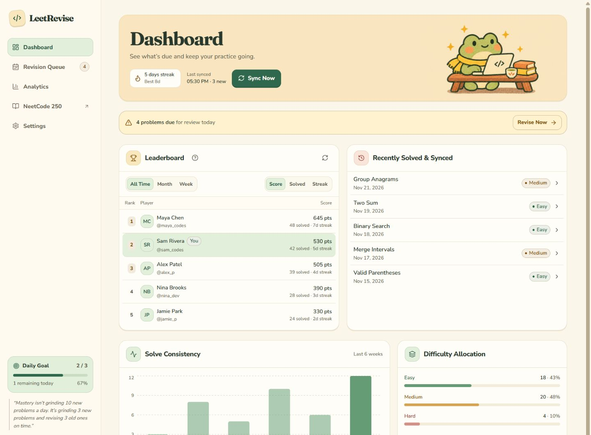

# LeetRevise

**Remember what you solve on LeetCode.**

LeetRevise is a spaced repetition app for coding interview practice. Import solved problems, see what’s due, and revisit problems on a schedule that adapts to how well you remember them.

[Open LeetRevise](https://leetcode-revision-tracker.vercel.app)

## How it works

1. **Import your solves.** Link your public LeetCode profile and use **Sync Now** to import up to six new accepted problems per sync. You can also add a problem by URL or slug.
2. **Review what’s due.** The revision queue prioritizes scheduled reviews while keeping older problems available. Search by title or topic, filter by difficulty or status, and star problems you want to revisit. Pause and resume individual review schedules as needed.
3. **Log how it went.** Reviews follow six intervals of **1, 3, 7, 14, 30, and 90 days**. An easy recall advances the schedule, an effortful recall repeats the current interval, and a forgotten solution restarts at one day. Skipping postpones the review until tomorrow. You can save solution notes and revisit your review history on each problem.

## Track your progress

- **Daily goal and streaks.** Track three reviews a day and see your current and best streaks.
- **Practice analytics.** See weekly solve activity, difficulty breakdown, and topics you’ve had trouble recalling.
- **Email reminders.** Choose your timezone and reminder time. The digest includes due reviews and can surface older problems you haven’t reviewed yet. Use **Pause Revision** on the dashboard to take a break from emails and resume whenever you’re ready.
- **Community leaderboard.** Compare scores, solved counts, and streaks across weekly, monthly, and all-time views.

## Contributing

Bug reports, feature suggestions, and pull requests are welcome. For a bug report, include the page, steps to reproduce it, and what you expected to happen. [Open an issue](https://github.com/VinitKumarGupta/LeetRevise/issues).

## License

The repository is licensed under the [MIT License](LICENSE).
